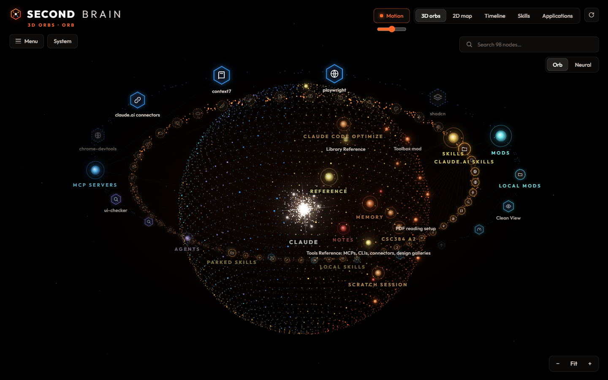
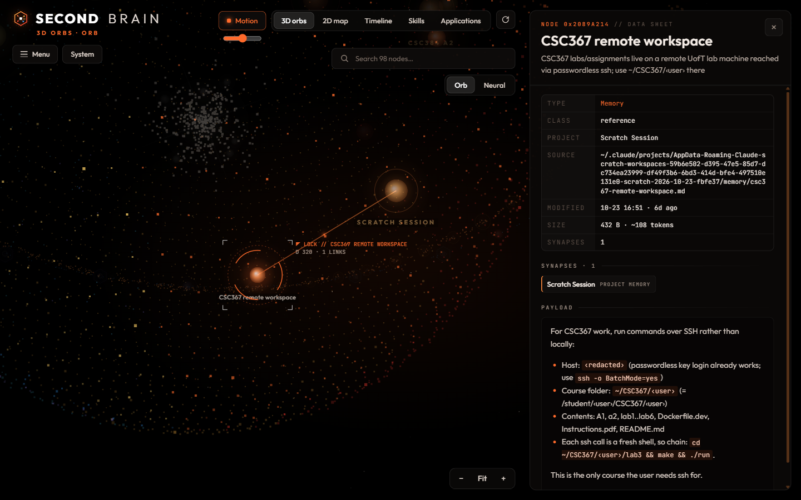
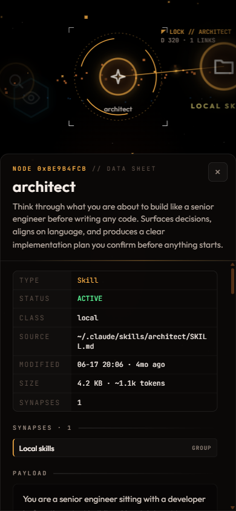
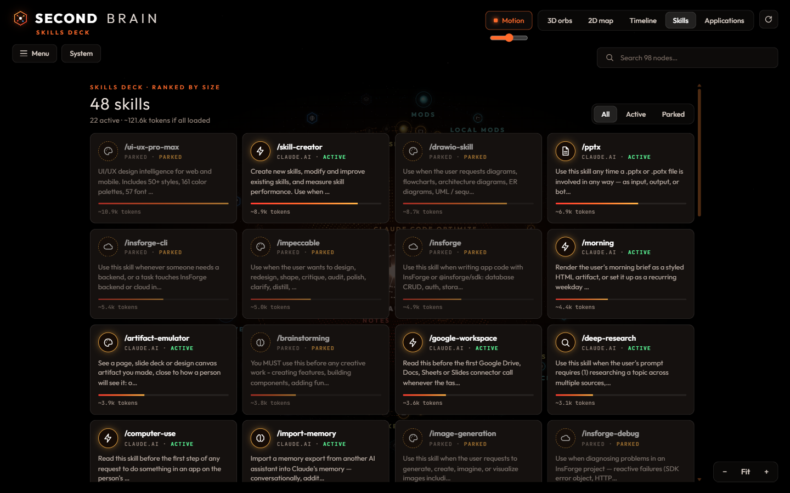
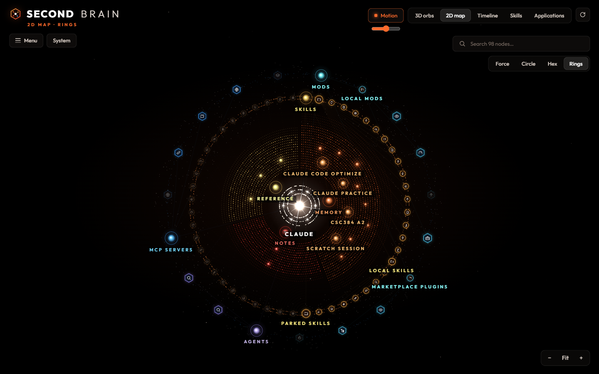
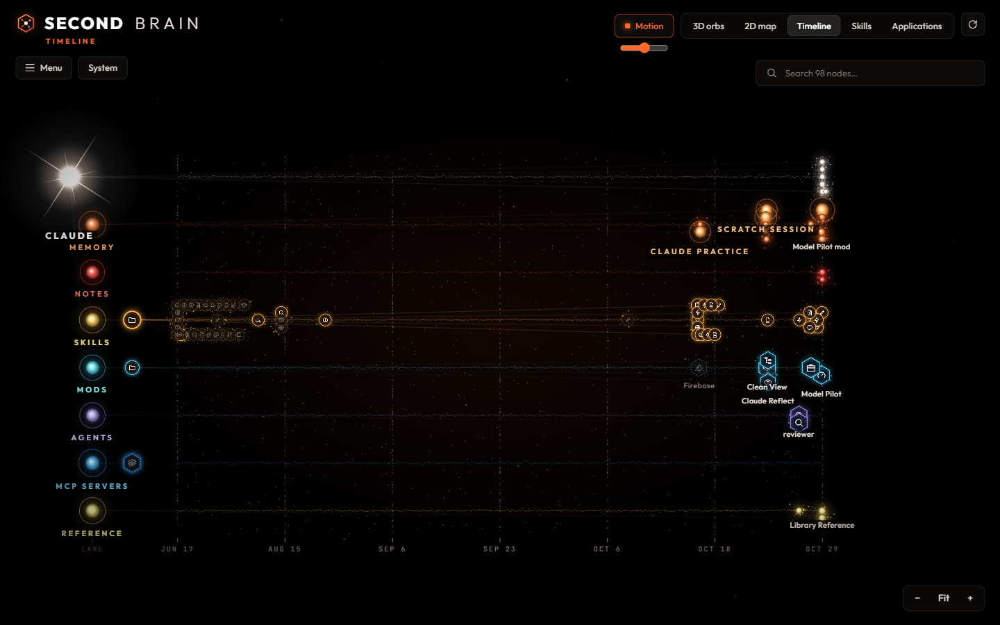
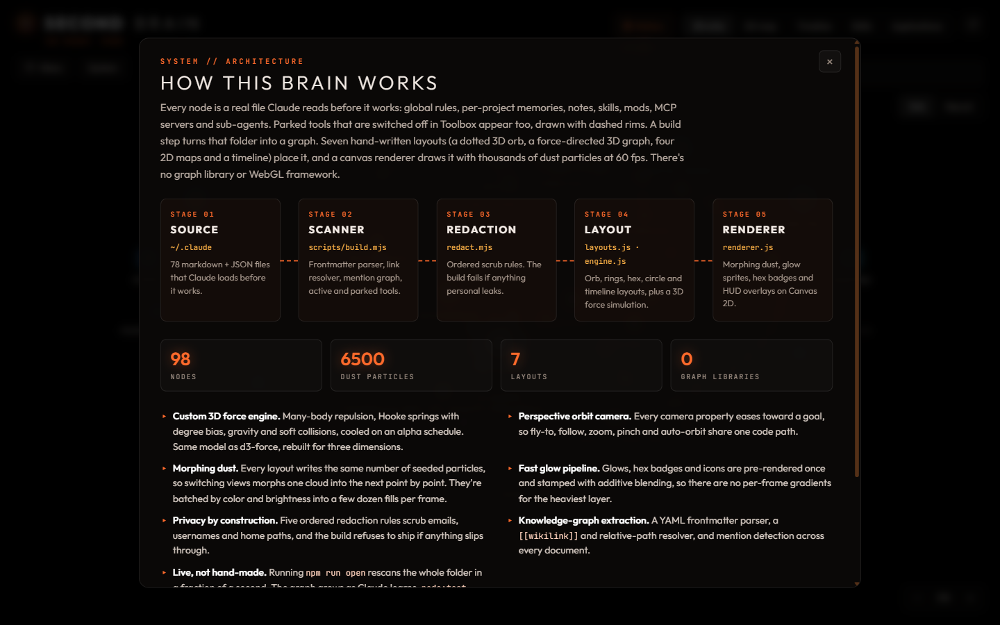

# Second Brain: A 3D Memory Visualizer for Claude Code

**See everything Claude Code knows about you, as an interactive 3D knowledge graph.**

**[▶ Live demo](https://abduldevhub.github.io/Claude-Code-Second-Brain/)** · [Run it on your own `~/.claude`](#run-it) · [How it works](#how-it-works)

[](https://abduldevhub.github.io/Claude-Code-Second-Brain/)
[](https://github.com/AbdulDevHub/Claude-Code-Second-Brain/actions/workflows/test.yml)
[](LICENSE)




## Project Overview

Claude Code remembers you through plain files in `~/.claude`: your `CLAUDE.md`, per-project memories, notes, skills, plugins, MCP servers and sub-agents. They're scattered across folders and hard to see as a whole. Second Brain turns them into something you can explore.

- **Every node is a real file**, and every line is a real link between files (`[[wikilinks]]`, references, tool mentions). Click one to read it.
- **Seven views of one brain:** a dotted 3D orb, a 3D force graph, 2D rings, hex, circle and force maps, and a timeline, with thousands of particles morphing between them.
- **Private by default:** a local build script scans and scrubs your files, and refuses to write output if anything personal survives.
- **Built from scratch:** hand-written layouts, 3D physics, camera and Canvas 2D renderer. No graph library, no WebGL, no npm dependencies. It opens straight from disk.

## What you are looking at

| | |
|---|---|
| **Core** (white sparkle, center) | `~/.claude/CLAUDE.md`, the global instructions loaded into every session. The white cluster around it holds its `##` sections. |
| **Hubs** (ringed, labelled) | One per category: Memory, Notes, Skills, Mods, MCP Servers, Agents, Reference. Each takes its category's color. |
| **Memories and notes** (orange, red) | `projects/*/memory/*.md`, the facts Claude saved per project, and the notes index, as bright points on the orb. |
| **Skills** (amber beads) | Local skills, claude.ai-synced skills and **parked** skills switched off in [Toolbox](#parked-tools), on the inner orbit ring. |
| **Apps** (blue hex badges) | Mods, marketplace plugins, MCP servers and agents on the outer ring. MCP servers show only a secret-free host or package name. |
| **Dashed rims** | Parked tools: installed but switched off. They carry no signal pulses. |
| **Solid / dashed lines** | Structure and `[[wikilinks]]` / mentions of a tool inside a document. Faint in the structured layouts, lit when you hover or select. |
| **Dust** | Decorative particles shaped by the layout and colored by the category whose sector they sit in. They aren't clickable. |

<table>
  <tr>
    <td width="62%"></td>
    <td width="38%"></td>
  </tr>
  <tr>
    <td><b>Click any node</b> and the camera flies to it and locks on. A data sheet shows its type, status, source file, connections and rendered contents.</td>
    <td><b>Works on phones</b>, with touch orbit, pinch zoom and a bottom sheet.</td>
  </tr>
</table>



## Views

| Tab | What it shows |
|---|---|
| **3D orbs** | **Orb**: the dotted sphere with its two orbit rings. **Neural**: the original force-directed 3D graph. |
| **2D map** | **Force**, **Circle**, **Hex** (honeycomb tiles) and **Rings** (concentric sectors per category, skills and apps on the outer rings). Drag pans. |
| **Timeline** | One lane per category, placed by last-modified date. Recent weeks get more room than old months. |
| **Skills** | A deck of every skill ranked by size, with its rough token cost and active/parked state. |
| **Applications** | MCP servers, mods and agents as hex tiles. |

The chrome stays minimal: tab pills, search, a Motion toggle with a speed slider, and zoom controls. **Menu** opens a drawer with telemetry, channels, the activity chart, the event log and the runtime readout.





## Features

- **Seven layouts, one cloud.** Every layout writes the same number of seeded dust particles, so switching views morphs one cloud into the next. Drag to orbit (pan in 2D), scroll or pinch to zoom, and drag nodes in the force layouts. Auto-orbit drifts when idle.
- **Data sheets.** Every node opens its real contents (sanitized markdown), metadata and clickable connections. Links between brain files jump to that node.
- **Parked tools.** Skills, mods and MCP servers switched off in Toolbox still appear with dashed rims, so the brain shows everything installed.
- **Menu drawer.** Telemetry with active/total counts, channel filters, a 30-day activity chart (click a day to light up what changed), an event log and a runtime readout.
- **Remembers your view.** The last tab and layout come back on the next visit.
- **Boot sequence.** A terminal-style cold start that reports what the scanner found, then the camera dives in.
- **System screen.** An in-app architecture overview for anyone curious how it works.
- **Privacy by construction.** Ordered redaction rules scrub emails, usernames and home paths. The build **fails** if anything personal survives, and MCP headers, env vars and arguments are never read into the output.



## How it works

```
~/.claude ──► scripts/build.mjs ──► redaction guard ──► data.js ──► js/layouts.js ──► js/renderer.js
  files        scan + link graph     scrub, then         window.     orb, rings, hex,  Canvas 2D:
               (frontmatter,         refuse to write     BRAIN       timeline + dust   morphing dust,
               wikilinks, mentions)  on any leak                     js/engine.js      glow sprites,
                                                                     physics, camera   hex badges
```

| Piece | What it does |
|---|---|
| [`scripts/lib/sources.mjs`](scripts/lib/sources.mjs) | One scanner per source (CLAUDE.md, memory, notes, skills, mods, plugins, agents, MCP, reference). It reads on/off state from the same places as the Toolbox mod. |
| [`scripts/lib/graph.mjs`](scripts/lib/graph.mjs) | Node/link registry with de-duplication and cross-link resolution: `[[wikilinks]]`, relative `.md` links, and name mentions with context rules so plain words like "review" don't create false links. |
| [`scripts/lib/redact.mjs`](scripts/lib/redact.mjs) | Ordered scrub rules (emails, then home paths in Windows/Git Bash/POSIX forms, then encoded project folders, then whole-word usernames) plus the final leak check. |
| [`js/layouts.js`](js/layouts.js) | Target positions for each structured layout (orb, circle, hex, rings, timeline), plus the seeded dust cloud and captions that go with it. Pure math, so the tests run it. |
| [`js/glyphs.js`](js/glyphs.js) | Line icons for tool badges, picked from a tool's name with a per-type fallback. |
| [`js/engine.js`](js/engine.js) | The d3-force model rebuilt for 3D (with a flat mode for the 2D force map): many-body repulsion, Hooke springs with degree bias, gravity, soft collisions and alpha cooling. Also an orbit camera where every property eases toward a goal. |
| [`js/renderer.js`](js/renderer.js) | Starfield, the dust cloud (morphed point by point and batched by color and brightness), synapses with travelling pulses, glowing knowledge nodes, hex and bead badges, and the sparkle core. Glows, badges and icons are pre-rendered once and stamped with additive blending. Labels are placed greedily with overlap culling. |
| [`js/app.js`](js/app.js) | HUD wiring: views and layouts, pointer and touch input, data sheet, skills and apps decks, menu drawer, filters, search, activity chart, boot sequence. |

**Performance notes.** Nodes and links are created with one fixed shape so V8 keeps property access monomorphic, which made the physics loop about 7x faster. Sprites replace per-frame gradients, stars and dust are batched by color and brightness into a few dozen fills per frame, and the HUD skips `backdrop-filter`, since a blur over a live canvas halves the frame rate.

## Run it

Requires Node 18.3+. There are no dependencies to install.

```bash
npm run build:demo   # optional: rebuild the bundled demo brain
npm run build        # scan your own ~/.claude into data.js
npm run open         # build, then open index.html in your browser
npm test             # 23 tests: parser, redaction, MCP secrets, odd config files, graph, camera, physics, layouts
```

`index.html` opens straight from disk. With no `data.js`, it falls back to the fictional demo brain in [`demo/`](demo/), so a fresh clone works right away.

### Build options

| Command | Result |
|---|---|
| `npm run build` | Your full brain, contents included. `data.js` is git-ignored. |
| `npm run build:public -- --out public/data.js` | Structure, titles and descriptions only, with document contents withheld. Memory titles and descriptions still ship, so read them before you publish. |
| `node scripts/build.mjs --redact my-handle` | Scrub extra words. You can also list them in `redact.local.txt` (git-ignored). |
| `node scripts/build.mjs --home path/to/home --out file.js` | Build from any folder that contains a `.claude` directory. |

<a id="parked-tools"></a>
### Parked tools

"Parked" means installed but switched off. I toggle tools with **Toolbox**, my own Claude Code mod that moves skills, mods and MCP servers between on and off locations without uninstalling them. The scanner reads the same state as the Toolbox mod: `~/.claude/skills-disabled/`, `CLAUDE_CODE_PLUGIN_DIRS` and `enabledPlugins` in `settings.json`, `mcpServers` in `~/.claude.json`, and `~/.claude/toolbox/parked-mcp.json`.

## Project layout

```
index.html            HUD markup and the System screen
css/style.css         HUD styling (desktop, tablet, phone)
js/layouts.js         orb, circle, hex, rings and timeline layouts + dust
js/glyphs.js          badge icons
js/engine.js          3D physics + orbit camera (no dependencies)
js/renderer.js        Canvas 2D renderer
js/app.js             HUD wiring and interaction
scripts/build.mjs     CLI entry: scan, redact, leak-check, write data.js
scripts/lib/          text helpers, redaction, graph, scanners
demo/ada/.claude      a fictional Claude home used by the demo and the tests
demo/data.js          the demo brain, built from it
test/                 node:test suites
docs/screenshots/     the images in this README
```

## Tech

Vanilla JavaScript (ES2022), Canvas 2D, Node.js. The browser loads only [marked](https://marked.js.org/) and [DOMPurify](https://github.com/cure53/DOMPurify) (pinned versions from cdnjs, with Subresource Integrity hashes) to render markdown safely. There's no framework, bundler or build step for the page itself.

## FAQ

**Does it upload my Claude Code memory anywhere?** No. The build runs locally and writes `data.js` next to `index.html`, and `data.js` is git-ignored. The page makes no network requests besides fonts and the two pinned markdown libraries.

**What does it read from `~/.claude`?** `CLAUDE.md`, `projects/*/memory/*.md`, notes, reference files, skills (local, claude.ai-synced and parked), plugins and mods, sub-agents, and the MCP server list from `~/.claude.json`. MCP headers, env vars and arguments are never read into the output.

**Can I share my brain publicly?** Use `npm run build:public`, which keeps structure, titles and descriptions but withholds document contents. Read the output first; memory titles still ship.

**Does it need a GPU or WebGL?** No. It renders with Canvas 2D and works on phones.

## License

[MIT](LICENSE) © Abdul Hadi Khan · [GitHub](https://github.com/AbdulDevHub) · [LinkedIn](https://www.linkedin.com/in/abdul-hadi-khan)
